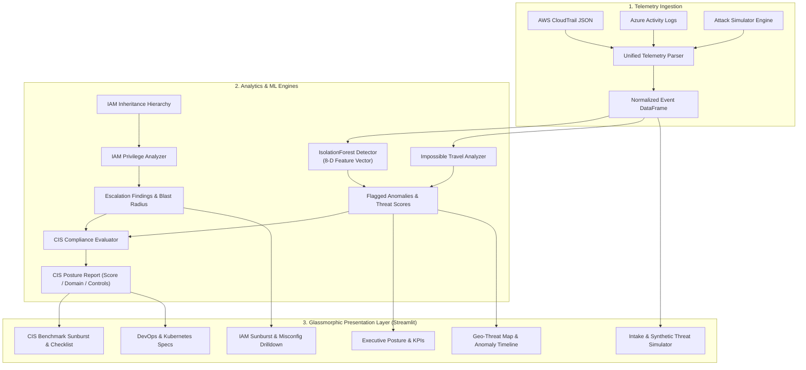

# 🛡️ CloudGuard IAM & CSPM Analyzer

[](https://www.python.org/)
[](https://streamlit.io/)
[](https://scikit-learn.org/)
[](https://www.docker.com/)
[](https://kubernetes.io/)
[](https://github.com/features/actions)
[](https://trivy.dev/)

**CloudGuard IAM & CSPM Analyzer** is an enterprise-grade Autonomous Cloud Security Posture Management (CSPM) and Identity & Access Management (IAM) Privilege Analytics platform. Engineered in Python 3.11 with Streamlit, Plotly, and scikit-learn, CloudGuard correlates multi-cloud audit logs (AWS CloudTrail & Azure Activity Logs) to detect behavioral API anomalies, impossible travel, privilege escalation paths, and CIS Foundations compliance gaps in real time.

---

## 📑 Table of Contents

- [Key Architecture & Capabilities](#-key-architecture--capabilities)
- [System Architecture](#-system-architecture)
- [Core Feature Modules](#-core-feature-modules)
  - [1. Behavioral ML Anomaly Detection (IsolationForest)](#1-behavioral-ml-anomaly-detection-isolationforest)
  - [2. IAM Privilege & Blast Radius Hierarchy](#2-iam-privilege--blast-radius-hierarchy)
  - [3. CIS Foundations Benchmark Compliance Engine](#3-cis-foundations-benchmark-compliance-engine)
  - [4. Attack Simulator & Telemetry Ingestion](#4-attack-simulator--telemetry-ingestion)
  - [5. DevSecOps & Production Orchestration](#5-devsecops--production-orchestration)
- [Project Structure](#-project-structure)
- [Quickstart & Local Development](#-quickstart--local-development)
  - [Prerequisites](#prerequisites)
  - [Installation](#installation)
  - [Running the Streamlit Dashboard](#running-the-streamlit-dashboard)
  - [Running Unit Tests & Quality Gates](#running-unit-tests--quality-gates)
- [Containerization & Docker Compose](#-containerization--docker-compose)
- [Kubernetes Deployment](#-kubernetes-deployment)
- [CI/CD Pipeline Specifications](#-cicd-pipeline-specifications)
- [License](#-license)

---

## 🚀 Key Architecture & Capabilities

1. **Autonomous Behavioral API Anomaly Detection**:
   - Uses **scikit-learn `IsolationForest`** trained on 8-dimensional feature vectors (sin/cos diurnal cycle, operational risk, principal frequency rarity, event rarity, high-risk geolocation weights).
   - Real-time detection of **Impossible Travel** (identities hopping foreign jurisdictions under 3 hours) and off-hours administrative activity.

2. **IAM Privilege Inheritance & Blast Radius Analytics**:
   - Multi-tier Sunburst hierarchy (`Root Account ➔ Category ➔ Entity ➔ Attached Policy ➔ Permission`).
   - Automated identification of wildcard administrative policies (`*:*`), inline escalations, and privilege escalation combinations (`iam:CreateAccessKey`, `iam:PassRole`, `iam:CreatePolicyVersion`, `iam:AttachUserPolicy`).
   - Dynamic quantitative **Blast Radius Score (0–100)** calculation.

3. **CIS Multi-Cloud Benchmark Compliance Evaluator**:
   - Maps posture against CIS AWS Foundations Benchmark v1.5 and CIS Azure Foundations Benchmark v2.0.
   - Evaluates Identity, Logging & Monitoring, Network Security, and Storage Encryption domains.
   - Generates executable CLI remediation commands (e.g., `aws iam detach-role-policy`).

4. **Multi-Source Telemetry Ingestion & Attack Simulator**:
   - Parses AWS CloudTrail JSON and Azure Activity Log JSON into a normalized schema.
   - Synthetic traffic generator supporting customizable event volume, anomaly contamination rates, and deterministic random seeds.
   - Export analyzed security events to CSV and flagged incidents to JSON.

5. **Enterprise DevSecOps Toolchain**:
   - Multi-stage minimal `python:3.11-slim` Dockerfile running under unprivileged user (`UID 10001`).
   - Production Kubernetes manifests (`Deployment`, `LoadBalancer Service`, `HPA`, `NetworkPolicy`, `ConfigMap`, `Secret`, `RBAC`).
   - DevContainer with preconfigured VS Code settings and Trivy vulnerability scanner.
   - GitHub Actions CI/CD with automated testing, Black formatting, Flake8 linting, Trivy vulnerability gates, and GHCR publishing.

---

## 🏛️ System Architecture



---

## 🔍 Core Feature Modules

### 1. Behavioral ML Anomaly Detection (IsolationForest)
- **Feature Extraction**:
  - Diurnal cyclical transformation: $\sin(2\pi \cdot \text{hour} / 24)$ and $\cos(2\pi \cdot \text{hour} / 24)$.
  - Operational risk multiplier for destructive and IAM API verbs.
  - Principal and event rarity metrics: $1.0 - (\text{count} / N)$.
  - Geopolitical threat score mapping based on origin ISO-3 country codes.
- **Threat Index Scoring**: Scores normalized to $[0.0, 1.0]$ with automated categorization into `CRITICAL` ($\ge 0.85$), `HIGH` ($\ge 0.65$), `MEDIUM` ($\ge 0.40$), and `LOW`.

### 2. IAM Privilege & Blast Radius Hierarchy
- Parses cloud permission graphs to identify over-privileged entities and lateral movement risks.
- Provides interactive radial zoom via Plotly Sunburst charts.
- Highlights exact policy JSON snippets and provides step-by-step remediation commands.

### 3. CIS Foundations Benchmark Compliance Engine
- Computes overall posture percentage and individual domain scores (Identity & Access Management, Logging & Monitoring, Network Security, Storage & Data Protection).
- Produces pass/fail status for each control with clickable drilldown tables.

### 4. Attack Simulator & Telemetry Ingestion
- Upload real AWS CloudTrail or Azure Activity JSON exports.
- Or synthesize attack scenarios with adjustable contamination rates ($1\% - 25\%$) to test SIEM pipelines and response workflows.

### 5. DevSecOps & Production Orchestration
- **Security Hardening**: Read-only root filesystem, dropped Linux capabilities (`ALL`), explicit non-root user `10001:10001`.
- **Health Probes**: Kubernetes `livenessProbe` and `readinessProbe` targeting `/_stcore/health`.
- **Zero-Trust NetworkPolicy**: Strictly restricts ingress to Streamlit port `8501` and egress to DNS (`53`) and outbound HTTPS (`443`).

---

## 📁 Project Structure

```text
sdp/
├── .devcontainer/
│   ├── Dockerfile                  # DevContainer with Python 3.11 & Trivy
│   └── devcontainer.json           # VS Code extensions, formatting, settings
├── .github/
│   └── workflows/
│       └── ci-cd.yml               # GitHub Actions CI/CD with Trivy & GHCR
├── data/
│   ├── aws_cloudtrail_sample.json  # Realistic AWS CloudTrail attack sample
│   └── azure_activity_sample.json  # Azure Activity Log sample
├── k8s/
│   ├── configmap.yaml              # Environment configuration
│   ├── deployment.yaml             # 2-replica hardened Deployment
│   ├── hpa.yaml                    # HorizontalPodAutoscaler (CPU/Mem)
│   ├── namespace.yaml              # cloudguard-system namespace
│   ├── networkpolicy.yaml          # Zero-trust NetworkPolicy
│   ├── secret.yaml                 # Multi-cloud credentials and webhooks
│   ├── service.yaml                # LoadBalancer Service on NodePort 30851
│   └── serviceaccount-rbac.yaml    # Least-privilege ServiceAccount & RBAC
├── src/
│   ├── __init__.py
│   ├── app.py                      # Main Streamlit dashboard application
│   ├── config.py                   # Configuration, geolocations, constants
│   ├── analytics/
│   │   ├── __init__.py
│   │   ├── anomaly_detector.py     # IsolationForest ML & impossible travel
│   │   ├── compliance_scorer.py    # CIS Foundations compliance evaluation
│   │   └── iam_analyzer.py         # IAM privilege and blast radius engine
│   ├── telemetry/
│   │   ├── __init__.py
│   │   ├── generator.py            # Dynamic attack scenario generator
│   │   ├── parser.py               # AWS CloudTrail & Azure Activity log parser
│   │   └── sample_data.py          # Enterprise baseline & IAM hierarchy
│   └── visualizer/
│       ├── __init__.py
│       ├── charts.py               # Plotly Express & Graph Objects charts
│       └── styles.py               # Glassmorphic dark cyber CSS & metric cards
├── tests/
│   ├── __init__.py
│   ├── test_anomaly_detector.py    # ML training, travel detection, edge cases
│   ├── test_compliance.py          # CIS compliance evaluation tests
│   ├── test_iam_analyzer.py        # IAM privilege & blast radius tests
│   └── test_telemetry.py           # Multi-cloud parser & simulator tests
├── .dockerignore                   # Docker build exclusions
├── .gitignore                      # Git tracking exclusions
├── Dockerfile                      # Production multi-stage hardened image
├── docker-compose.yml              # Local container orchestration
├── pyproject.toml                  # Black formatting & Pytest settings
├── requirements.txt                # Production Python dependencies
├── requirements-dev.txt            # Development & testing dependencies
├── setup.cfg                       # Flake8 configuration
└── README.md                       # Comprehensive platform documentation
```

---

## ⚡ Quickstart & Local Development

### Prerequisites
- **Python**: 3.11 or 3.12
- **pip** and **virtualenv**
- (Optional) **Docker Desktop** & **kubectl** for container/cluster deployment

### Installation

1. **Clone the repository and navigate into the workspace:**
   ```bash
   cd d:\sdp
   ```

2. **Create and activate a Python virtual environment:**
   ```bash
   # Windows PowerShell
   python -m venv .venv
   .\.venv\Scripts\Activate.ps1

   # Linux / macOS
   python3 -m venv .venv
   source .venv/bin/activate
   ```

3. **Install application and development dependencies:**
   ```bash
   pip install --upgrade pip
   pip install -r requirements-dev.txt
   ```

### Running the Streamlit Dashboard

Launch the interactive application locally:
```bash
streamlit run src/app.py
```
Open your browser at `http://localhost:8501`.

### Running Unit Tests & Quality Gates

Run the complete automated test suite:
```bash
pytest -v tests/
```

Verify code formatting and styling:
```bash
# Code format check
black --check src tests

# Flake8 linting
flake8 src tests
```

---

## 🐳 Containerization & Docker Compose

### Multi-Stage Docker Build
Build the hardened, unprivileged production container:
```bash
docker build -t cloudguard-analyzer:latest .
```

Run the container in standalone mode:
```bash
docker run -p 8501:8501 --rm --name cloudguard cloudguard-analyzer:latest
```

### Docker Compose
Launch the service with defined resource limits and health checks:
```bash
docker compose up --build -d
```
Inspect container logs:
```bash
docker compose logs -f
```
Stop the service:
```bash
docker compose down
```

---

## ☸️ Kubernetes Deployment

Deploy CloudGuard to any Kubernetes cluster (Minikube, Kind, EKS, GKE, AKS):

1. **Apply the dedicated namespace:**
   ```bash
   kubectl apply -f k8s/namespace.yaml
   ```

2. **Apply configuration, secrets, and RBAC:**
   ```bash
   kubectl apply -f k8s/configmap.yaml
   kubectl apply -f k8s/secret.yaml
   kubectl apply -f k8s/serviceaccount-rbac.yaml
   ```

3. **Deploy the application workloads:**
   ```bash
   kubectl apply -f k8s/deployment.yaml
   kubectl apply -f k8s/service.yaml
   kubectl apply -f k8s/hpa.yaml
   kubectl apply -f k8s/networkpolicy.yaml
   ```

4. **Verify deployment health:**
   ```bash
   kubectl get pods -n cloudguard-system
   kubectl get svc -n cloudguard-system
   ```

---

## 🔄 CI/CD Pipeline Specifications

The GitHub Actions workflow (`.github/workflows/ci-cd.yml`) automates 3 sequential stages on every push and pull request:

1. **Quality Gate (`lint-and-test`)**:
   - Executes `black --check --diff` for style consistency.
   - Runs `flake8` for syntax and linting checks.
   - Runs `pytest` against all 4 unit test suites.
2. **DevSecOps Gate (`security-audit`)**:
   - Scans repository dependencies and files with `aquasecurity/trivy-action`.
   - Checks for exposed secrets and CVEs in dependencies.
3. **Packaging & Delivery (`build-and-publish`)**:
   - Executes Docker Buildx multi-stage build.
   - Scans output container image with Trivy.
   - Authenticates and publishes tagged container images (`latest`, `git-sha`) to GitHub Container Registry (`ghcr.io`).

---

## 📄 License

This project is licensed under the Apache 2.0 License.
